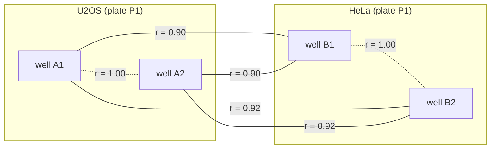

[](https://github.com/WayScience/pairwise_compare/actions/workflows/tests.yml)
[](https://codecov.io/gh/WayScience/pairwise_compare)
# Pairwise Compare
Compare the rows of a [tidy](https://www.jstatsoft.org/article/view/v059i10) pandas dataframe in pairs, for example the correlation between the profiles of wells that differ in their cell line.
You choose which columns must be different and which must be the same between the two rows of a pair, and get one result per pair.

**The problem it solves:** as an analyst of image-based profiles, I need the similarity of every pair of samples that differ in one way and match in another (for example, wells of different cell lines on the same plate), so that I can see how replicates agree and how groups differ, because the average of a group hides how its samples relate.



Each line is one result: the Pearson correlation `r` of two wells.
Solid lines join wells of different cell lines, and dashed lines join the replicate wells of one cell line.

The [example notebook](docs/example_pairwise_comparisons.ipynb) uses a dataset from the [nf1_schwann_cell_painting_data](https://github.com/WayScience/nf1_schwann_cell_painting_data).
Most of the development is in the `src` folder.

## Quick start
Take four wells of one plate, with the metadata that identify them and four measured features:

```python
import pandas as pd
from pairwise_compare import compare_pairs

wells = pd.DataFrame(
    {
        "plate": ["P1", "P1", "P1", "P1"],
        "cell_line": ["U2OS", "U2OS", "HeLa", "HeLa"],
        "well": ["A1", "A2", "B1", "B2"],
        "area": [10.0, 11.0, 20.0, 19.0],
        "intensity": [5.0, 5.5, 2.0, 2.5],
        "texture": [0.1, 0.3, 0.9, 0.7],
        "eccentricity": [0.5, 0.4, 0.8, 0.9],
    }
)

compare_pairs(
    wells,
    different=["cell_line", "well"],  # the two wells of a pair are of different cell lines
    features=["area", "intensity", "texture", "eccentricity"],
    same=["plate"],  # and are on the same plate
)
```

The result has one row per pair of wells, with their Pearson correlation across the features:

| pearsons_correlation | plate__group0 | plate__group1 | cell_line__group0 | cell_line__group1 | well__group0 | well__group1 |
| --- | --- | --- | --- | --- | --- | --- |
| 0.90 | P1 | P1 | HeLa | U2OS | B1 | A1 |
| 0.90 | P1 | P1 | HeLa | U2OS | B1 | A2 |
| 0.92 | P1 | P1 | HeLa | U2OS | B2 | A1 |
| 0.92 | P1 | P1 | HeLa | U2OS | B2 | A2 |

This call compares wells of different cell lines (the solid lines in the picture).
Wells of the same cell line are not compared with each other.

To compare the replicate wells of each cell line instead (the dashed lines), keep the cell line the same and ask for different wells:

```python
compare_pairs(
    wells,
    different=["well"],  # the two wells of a pair are different wells
    features=["area", "intensity", "texture", "eccentricity"],
    same=["plate", "cell_line"],  # of the same cell line on the same plate
)
```

| pearsons_correlation | plate__group0 | plate__group1 | cell_line__group0 | cell_line__group1 | well__group0 | well__group1 |
| --- | --- | --- | --- | --- | --- | --- |
| 1.00 | P1 | P1 | HeLa | HeLa | B1 | B2 |
| 1.00 | P1 | P1 | U2OS | U2OS | A1 | A2 |

Each column must either match (`same`) or differ (`different`), so one call gives one kind of pair.
To get every pair of different wells in one call, use `different=["well"]` and `same=["plate"]`.
The results only hold the columns you name, so add the cell line to each pair afterwards by looking it up from its well.

## Installation
You can install the package with either of the following commands:<br>
`pip install pairwise-compare`<br>
`uv add pairwise-compare`

## Data format
The dataframe is [tidy](https://www.jstatsoft.org/article/view/v059i10), as described by Wickham (2014): one row per sample (for example, one well) and one column per variable.
- **Group columns** hold the metadata that define which rows are compared, such as the plate, the cell line, or the well.
  They are the columns listed in `different`, `same` and `drop`.
- **Feature columns** hold the numbers that are compared, such as measurements of the cell morphology.
  They are listed in `features` and must be numeric.

All other columns are ignored.

## Which rows are compared
- Two rows are compared when they have a different value in **every** `different` column and, if `same` is given, the same value in **every** `same` column.
- `different` needs at least two columns, or one column and at least one `same` column.
  A column cannot be in both.
- Each pair is compared once: the pair (A, B) is not repeated as (B, A), and a row is not compared with itself.
- `group0` and `group1` in the output are the two rows of a pair.
  For a `same` column both have the same value.
- `drop` leaves columns of `same` or `different` out of the results.
  They still decide which rows are compared.
  For example, `drop=["Metadata_Well"]` removes the well columns and keeps the others.

## Missing values
- A row with a missing value in a `same` or `different` column is **left out** of the comparisons, with a warning that says how many rows and which columns.
- A row with a missing value in a feature column is kept, and the results of its comparisons are missing (NaN), with a warning.
- Missing values in other columns are ignored.
- A row with the same value in every feature has no Pearson correlation (NaN), with a warning.

## Order of the results
- The first row of a pair (`group0`) is the one that comes first by its values in the group columns, and the second row (`group1`) comes after it.
  With `same` columns, rows are first compared by their `same` values, and then by their `different` values, column by column.
  Without `same` columns, rows are compared by the first `different` column, and then by the other ones.
- The pairs are sorted by these keys, in this order:
  1. the `same` columns (both rows of a pair have the same values in them), or, without `same` columns, the first `different` column of `group0` and then of `group1`;
  2. the `different` columns of `group0` (the other ones without `same` columns) and then those of `group1`;
  3. the position in the dataframe of `group0` and then of `group1`.

## Other comparisons
`compare_pairs` uses the Pearson correlation by default.
To compare the rows another way, pass a comparator, which is a class that inherits from `Comparator` (see [Comparator.py](src/pairwise_compare/comparators/Comparator.py) and the examples in [test_comparator.py](tests/test_comparator.py)).
A comparator has a name, which is the name of its column in the results, and two methods:
- `prepare(values)` is called once with the feature values of all the compared rows (a numpy array with one row per sample), and returns whatever `compare` needs.
  By default, it returns the values as they are.
- `compare(prepared, rows0, rows1)` returns one value for each pair of rows `(rows0[k], rows1[k])`, as a numpy array.

A comparator keeps no results, so the same comparator can be used for any number of calls to `compare_pairs`.

## Speed
All the pairs are found and compared with array operations, so the time grows with the number of pairs and the number of features, not with a loop over the groups.
The [speed test notebook](docs/speed_test.ipynb) times `compare_pairs` for plates of several sizes, so you can see how long a comparison of your size takes.

The memory use depends on the number of pairs.
The results table needs memory for every pair, and finding the pairs inside one group of `same` values needs memory for every combination of two rows of the group.
Together they peaked at about 80 bytes for every combination of two rows in a test with one group (100 features, a group of 6,000 rows: 18 million pairs, 2.9 GB, 3 seconds), so a group of 20,000 rows would need about 32 GB.
Add a `same` column that splits very large groups into smaller ones.

## Citation
If you use Pairwise Compare, please cite it with the metadata in [CITATION.cff](CITATION.cff) (the "Cite this repository" button of GitHub uses it).
The tidy data format is described in:

Wickham, H. (2014). [Tidy Data](https://www.jstatsoft.org/article/view/v059i10). *Journal of Statistical Software*, 59(10), 1-23.

## Development
See [CONTRIBUTING.md](CONTRIBUTING.md) for how to run the tests and make a release.
